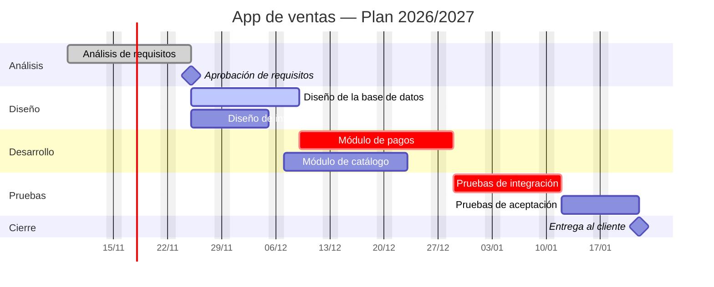

# App de ventas — Plan de proyecto

Proyecto de desarrollo de una aplicación de ventas para [cliente].
**Estado:** en curso · **Inicio:** 09/11/2026 · **Fin previsto:** 15/01/2027

| Campo | Valor |
|---|---|
| Director de proyecto | Ana Ruiz |
| Cliente | Distribuciones Norte S.L. |
| Alcance | Catálogo, pagos y panel de pedidos |
| Presupuesto | 48.000 € |

## Diagrama de Gantt

## Cronograma

| ID | Tarea | Responsable | Inicio | Fin | Depende de | Estado | % |
|----|-------|-------------|--------|-----|------------|--------|---|
| 1.1 | Análisis de requisitos | Ana | 09/11/2026 | 24/11/2026 | — | Hecha | 100 |
| 1.2 | Diseño de la base de datos | Luis | 25/11/2026 | 08/12/2026 | 1.1 | En curso | 60 |
| 1.3 | Diseño de interfaces | Marta | 25/11/2026 | 04/12/2026 | 1.1 | En curso | 40 |
| 1.4 | Módulo de pagos | Luis | 09/12/2026 | 28/12/2026 | 1.2 | Pendiente | 0 |
| 1.5 | Módulo de catálogo | Marta | 07/12/2026 | 22/12/2026 | 1.3 | Pendiente | 0 |
| 1.6 | Pruebas de integración | QA | 29/12/2026 | 12/01/2027 | 1.4 | Pendiente | 0 |
| 1.7 | Pruebas de aceptación | QA + cliente | 13/01/2027 | 22/01/2027 | 1.6 | Pendiente | 0 |

## Tareas del hito actual

- [x] Análisis de requisitos ([#12](../../issues/12))
- [ ] Diseño de la base de datos ([#13](../../issues/13))
- [ ] Diseño de interfaces ([#14](../../issues/14))

## Registro de riesgos

| ID | Riesgo | Prob. | Impacto | Severidad | Estrategia | Contingencia | Responsable |
|----|--------|-------|---------|-----------|------------|--------------|-------------|
| R1 | El proveedor de pagos no certifica a tiempo | 4 | 5 | 20 (alto) | Mitigar | Activar pasarela alternativa | Luis |
| R2 | Rotación del desarrollador clave | 2 | 4 | 8 (medio) | Transferir | Formar a un segundo | Ana |
| R3 | Cambio de requisitos en el checkout | 3 | 3 | 9 (medio) | Aceptar | Reserva de 5 días | Marta |

## Documentación

- [Actas de reunión](actas/)
- [Registro de decisiones](DECISIONES.md)
- [Especificación funcional](docs/especificacion.md)
